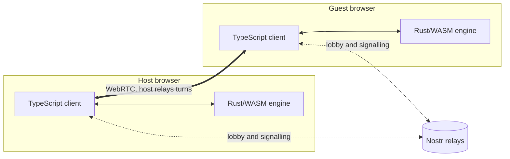

<div align="center">

# Graph Fight

**Shoot your friends with math.** A worms-like game where every shot is a formula.
Inspired by [Graphwar](https://graphwar.com/graphwar_1/index.html).

[](https://graph-fight.marceigual.eu)

[](https://github.com/jmigual/graph-fight/actions/workflows/pages.yml)
[](https://github.com/jmigual/graph-fight/tags)
[](https://graph-fight.marceigual.eu)
[](LICENSE.md)


</div>

## ✨ Features

- **Two fields.** XY field (2 players, `y = f(x)`) or polar disc (2-8 players, `r = f(θ)`).
- **Explicit or parametric formulas.** `y = f(x)`, or `x(t)`, `y(t)`; on the disc `r = f(θ)`, or `r(t)`, `θ(t)`.
- **Your choice of coordinates.** Map-centred like Graphwar (the default), or centred on the player who shoots. Either way a shot starts at the player.
- **Formula editor.** Helper buttons, saved formulas, templates with Desmos-like sliders, and typing `theta` or `pi` gives `θ` or `π`.
- **Bots** at three levels: Easy, Medium and Hard.
- **Local players.** Hot-seat players take turns at the host's screen, next to bots and remote guests.
- **Private games.** Listed with a lock and joined with a password, or left out of the lobby and joined through an invite link.
- **Kick.** The host can remove a guest from the waiting room, or mid-game; that team is out.
- **Reconnection.** A dropped player keeps their seat and catches up by replaying the game log.
- **No server.** Players connect peer-to-peer over WebRTC ([Trystero](https://github.com/dmotz/trystero)) and find each other through a lobby on public [Nostr](https://nostr.com) relays.
- **Deterministic Rust/WASM engine.** Peers exchange only the seed and formulas; every outcome is computed locally in WebAssembly.

## 🎮 How to play

1. Open the [live site](https://graph-fight.marceigual.eu), then host a game or join one from the lobby.
2. The host picks the field, the coordinates, who plays (guests, bots, local players) and whether the game is private.
3. On your turn, type a formula. The curve starts at your character and flies until it hits a player (they die), an obstacle (it leaves a crater), or the edge of the field.
4. Last team standing wins.

## 📸 Screenshots

<table>
  <tr>
    <td align="center"><br>Lobby: open games found on the Nostr relays; the padlock marks a game that needs a password.</td>
    <td align="center"><br>XY field: the last shot, the roster and the formula editor with its helper buttons.</td>
  </tr>
  <tr>
    <td align="center"><br>Polar disc field with 4 players (dark theme); the last shot was fired clockwise.</td>
    <td align="center"><br>Saved formulas: a template with its sliders open.</td>
  </tr>
</table>

<details>
<summary>On a phone</summary>


The same game on a 390 px wide phone screen.

</details>

## 🧱 How it works



Each browser runs the same WASM engine. The host sequences and relays every message and owns the
turn clock; guests send formulas, and every peer replays the same game from the shared seed.
Design decisions are recorded as ADRs (see [Design decisions](#-design-decisions)).

## 🛠️ Development

Prerequisites:

- [Rust](https://www.rust-lang.org/tools/install) with the `wasm32-unknown-unknown` target: `rustup target add wasm32-unknown-unknown`
- [wasm-pack](https://rustwasm.github.io/wasm-pack/installer/)
- [Node.js](https://nodejs.org/) 22

```bash
npm ci
npm start          # wasm build once, then esbuild watch + serve on :8080
npm run build:wasm # rebuild the wasm (pkg/); run in another terminal after Rust changes, `npm start` picks it up
npm run build      # wasm, type check (tsc) and bundle into dist/
npm test           # Rust and net tests
npm run e2e        # browser P2P test (Playwright); needs public relays
```

Run `npx playwright install chromium` once before the first `npm run e2e`.

Local builds (`npm start`, `npm run build`, `npm run e2e`) use a separate dev lobby; only the deploy workflow announces on the live one (`GRAPH_FIGHT_LOBBY=live`).

### Deployment

[`.github/workflows/pages.yml`](.github/workflows/pages.yml) tests, builds and deploys `dist/` to GitHub Pages on every push to
`master`. The site is served at https://graph-fight.marceigual.eu. DNS and Pages settings are
described in [docs/adr/0010](docs/adr/0010-hosting-github-pages-custom-domain.md).

## 📐 Design decisions

Decisions are recorded as ADRs: [docs/adr/README.md](docs/adr/README.md) (index of all ADRs; start there).

## 📄 License

Released under the [MIT License](LICENSE.md).
