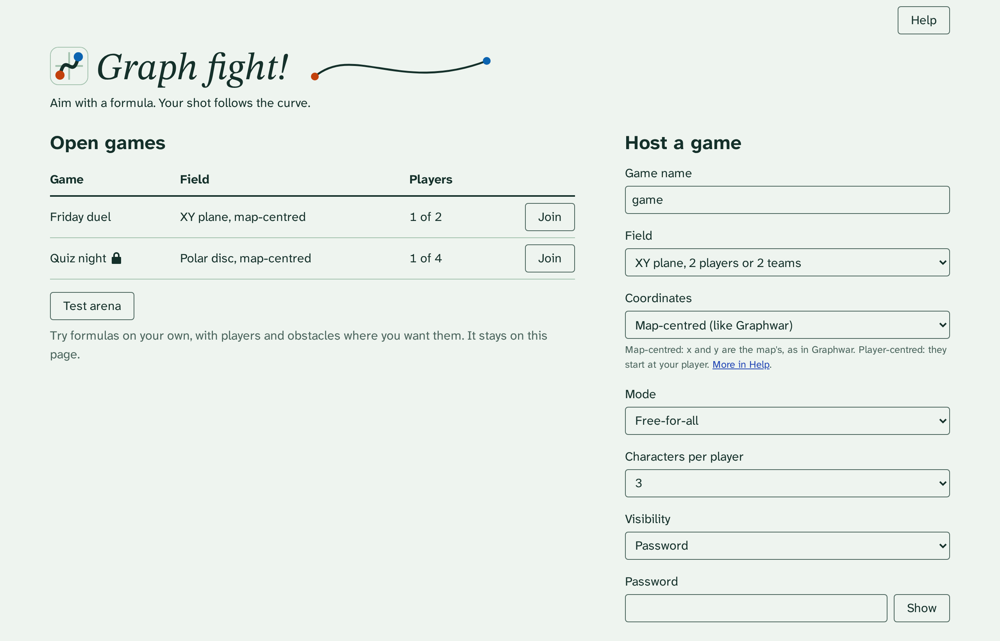
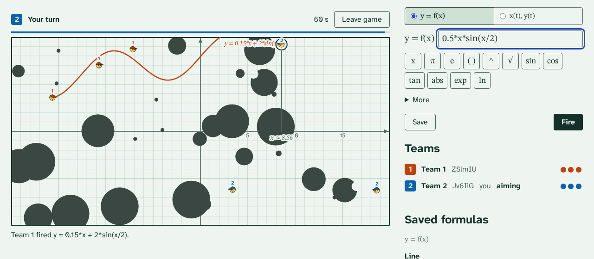
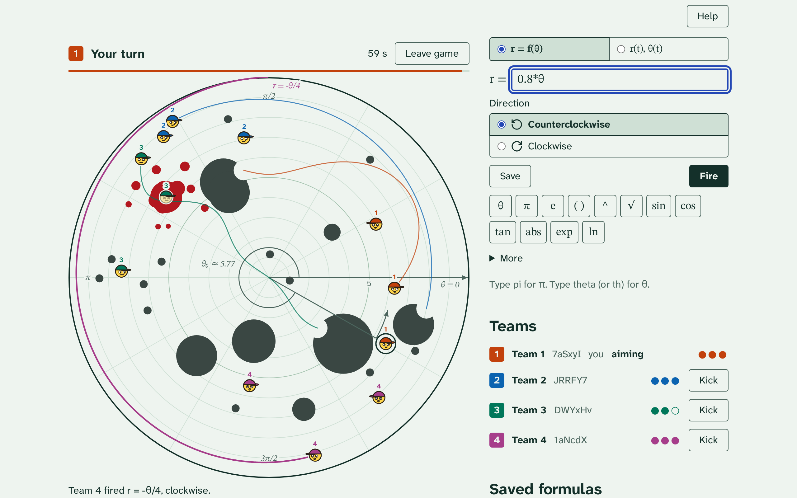
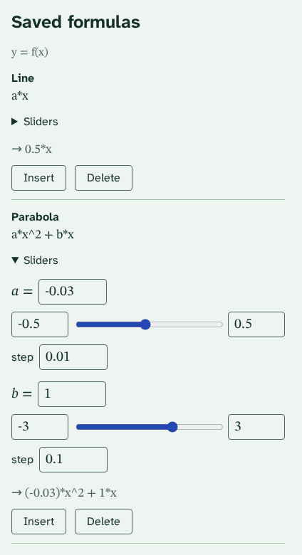
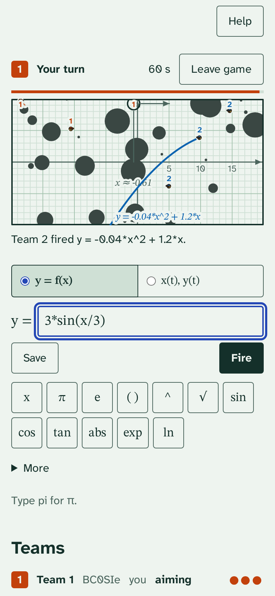

# Graph Fight

A worms-like game where players use formulas to attack each other. Inspired by [Graphwar](https://graphwar.com/graphwar_1/index.html)

Each shot is a formula path:

- XY field (2 players): `y = f(x)` or parametric `x(t)`, `y(t)`.
- Polar disc field (2-8 players): `r = f(θ)` or parametric `r(t)`, `θ(t)`.

The host picks the coordinates: centred on the map, like Graphwar (the default), or on the player
who shoots. Either way a shot starts at the player.

The host can add local players, who take turns at the host's screen, next to bots and remote guests.

The host can remove a guest from the waiting room, or kick one mid-game; that team is out.

There is no server. Players connect peer-to-peer over WebRTC (Trystero), and a lobby on public
Nostr relays lets them find each other.

## Screenshots


The lobby lists open games found on the Nostr relays.


XY field: the last shot, the roster and the formula editor with its helper buttons.


Polar disc field with 4 players (dark theme); the last shot was fired clockwise.


Saved formulas: a template with its sliders open.



The same game on a 390 px wide phone screen.

## Prerequisites

- [Rust](https://www.rust-lang.org/tools/install) with the `wasm32-unknown-unknown` target: `rustup target add wasm32-unknown-unknown`
- [wasm-pack](https://rustwasm.github.io/wasm-pack/installer/)
- [Node.js](https://nodejs.org/) 22

## Usage

```bash
npm ci
npm start          # wasm build once, then esbuild watch + serve on :8080
npm run build:wasm # rebuild the wasm (pkg/); run in another terminal after Rust changes, `npm start` picks it up
npm run build      # wasm, type check (tsc) and bundle into dist/
npm test           # Rust and net tests
npm run e2e        # browser P2P test (Playwright); needs public relays
```

Run `npx playwright install chromium` once before the first `npm run e2e`.

Local builds (`npm start`, `npm run build`, `npm run e2e`) use a separate dev lobby; only the deploy workflow announces on the live one (`GRAPH_FIGHT_LOBBY=live`).

## Deployment

`.github/workflows/pages.yml` tests, builds and deploys `dist/` to GitHub Pages on every push to
`master`. The site is served at https://graph-fight.marceigual.eu. DNS and Pages settings are
described in [docs/adr/0010](docs/adr/0010-hosting-github-pages-custom-domain.md).

## Design

Design decisions: [docs/adr/README.md](docs/adr/README.md) (index of all ADRs; start there).
